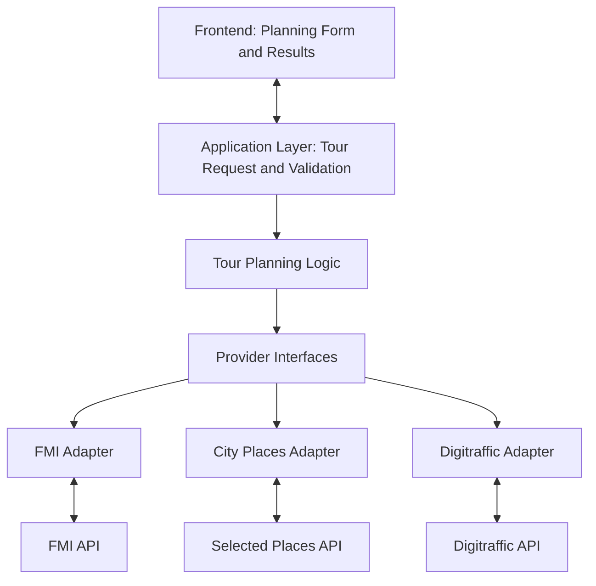
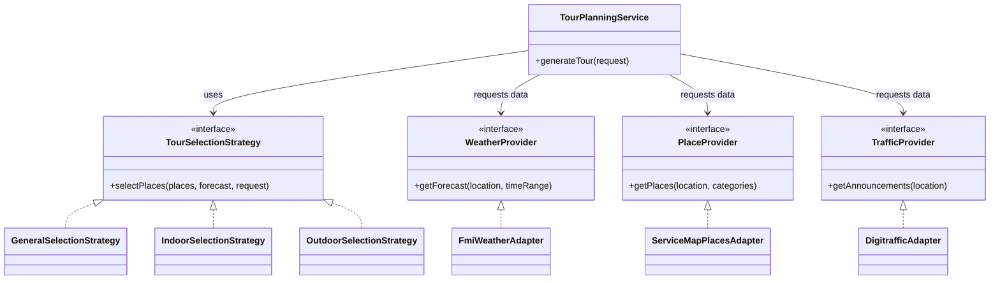

# City Tour Planner
## Prototype and Initial Design Document

**Course:** COMP.SE.110 Software Design, 2026–2027  
**Submission:** Prototype submission  
**Project:** City Tour Planner  
**Document status:** Initial design; some decisions remain provisional

---

## 1. Project Overview

City Tour Planner is a proposed application that helps users plan a visit to a city. A user provides preferences such as the city, date, start time, tour duration, place categories, and preferred activity setting. The application combines information from external data sources and applies its own planning logic to produce a suggested sequence of places.

The planned result view includes an itinerary, map markers for selected places, and weather information. Traffic-related information may also be shown when it is relevant to the selected area and available from the chosen data source.

The application is intended to support multiple cities. Helsinki is the initial test city used to investigate API responses; it is not the intended limit of the product. The purpose of the project is to demonstrate how data from independent APIs can be integrated into one application and used to provide a useful, adjustable result across supported cities.

### 1.1 Main user workflow

1. The user selects a city, date, start time, and tour duration.
2. The user selects preferred place categories and a weather preference, such as Auto, Indoor, or Outdoor.
3. The backend retrieves relevant information from configured external data sources.
4. The application normalizes the retrieved data and applies its own filtering and tour-selection logic.
5. The application returns a suggested itinerary for display.
6. The user reviews the stops, map, weather visualization, and available traffic information.

### 1.2 Scope

**Planned for the initial application**

- Letting the user choose from multiple supported cities.
- Collecting tour preferences from the user.
- Retrieving weather, place, and traffic-related information for the selected city from external sources.
- Filtering candidate places according to the user's preferences.
- Applying application-side rules to select and order stops.
- Displaying the proposed itinerary and its places on a map.
- Visualizing relevant forecast information.
- Displaying relevant traffic announcements when available.

**Outside the initial scope**

- Booking places, transport, or activities.
- Payments or user accounts.
- Full turn-by-turn navigation.
- Live GPS tracking.
- Guaranteed optimal routes or exact travel times without a suitable routing source.
- Train departure and delay information unless a suitable data source is separately selected and tested.

The initial implementation should not claim information that the selected data sources do not provide. Features may be revised as the group validates the APIs and refines the design.

---

## 2. Data Sources and API Feasibility

The group has developed a separate API Research Runner to test candidate endpoints. The runner sends requests to configured endpoints and records status codes, response times, content types, response previews, and errors in a JSON report.

The current research configuration has returned HTTP 200 responses from the following three endpoints. This establishes basic endpoint accessibility during testing; it does not by itself confirm that every field required by the UI is available or that the data is suitable for every city and date.

### 2.1 Finnish Meteorological Institute (FMI)

**Purpose:** Provide weather forecast data for the selected location and time.

**Planned use:**

- Retrieve forecast values for the requested location and time period.
- Extract the forecast measurements and timestamps available from the selected FMI query.
- Use supported values in the weather visualization.
- Use available weather information as one input to the tour-selection rules.

**Feasibility and limitations:** The configured forecast endpoint has returned HTTP 200 with an XML response. The exact fields, units, temporal coverage, and availability of precipitation probability must be verified against the chosen forecast query before those values are shown in the UI.

### 2.2 Digitraffic

**Purpose:** Provide road traffic announcements and related traffic information.

**Planned use:**

- Retrieve traffic announcements.
- Inspect the available fields and location information.
- Filter and display announcements relevant to the selected area when the response supports that operation.

**Feasibility and limitations:** The configured traffic-announcements endpoint has returned HTTP 200 with a JSON response. This endpoint does not establish that train departure times or delays are available. Those features would require a separately identified and tested source.

### 2.3 Service Map place data

**Purpose:** Provide service and location records that may be used to identify candidate places in supported cities.

**Planned use:**

- Retrieve service-location records.
- Inspect names, coordinates, categories, and other available fields.
- Filter records to identify places relevant to the user's selected categories.
- Use coordinates to place selected locations on a map.

**Feasibility and limitations:** The configured `/unit/` endpoint has returned HTTP 200 with JSON records. The response includes general city services, so not every returned unit should be treated as a tourist attraction. The group must verify available categories and filter the data appropriately.

The Service Map dataset covers Helsinki and other municipalities in the Helsinki metropolitan area, including Espoo, Vantaa, and Kauniainen; its documented coverage should be checked before enabling a city in the application. The group tested Helsinki first to understand the response, not because the product should be restricted to Helsinki.

For cities outside the Service Map coverage, the application will need another suitable places dataset or provider. The endpoint supports municipality/area filtering, so the selected city must be used when retrieving place records.

References:
- [Official Service Map API documentation](https://www.hel.fi/palvelukarttaws/restpages/ver4.html)
- [Service Map dataset coverage description](https://avoindata.suomi.fi/data/en_GB/dataset/paakaupunkiseudun-palvelukartan-rest-rajapinta)

### 2.4 Data combination

The APIs supply data; the application's own logic combines and interprets it. The planned process is:

1. Resolve the selected city and its supported data coverage.
2. Retrieve the forecast, place records, and relevant traffic announcements for that city.
3. Convert provider-specific responses into application-level data models.
4. Filter places using available categories and the user's preferences.
5. Apply weather-based suitability rules when the necessary data is available.
6. Select and order candidate stops within the requested tour duration.
7. Return the itinerary and visualization data to the frontend.

The first version may use estimated visit durations and a simple stop-ordering heuristic. Coordinates alone do not provide an actual pedestrian route or reliable walking duration. Any route line drawn between stops must therefore be presented as a suggested visit sequence unless routing data is added.

---

## 3. Planned Technologies

The following technologies are planned or currently used in the research utility. Choices that are not yet finalized are explicitly marked as provisional.

| Area | Planned technology | Purpose / status |
|---|---|---|
| Backend language | Java 22 | Application and tour-planning logic |
| Backend framework | Spring Boot 3.5.6 | Backend application structure and dependency management |
| Build tool | Maven | Build and run the Java project |
| HTTP communication | Java HTTP Client / suitable Spring HTTP support | Requests to external APIs; final production choice to be confirmed |
| Configuration | YAML with Spring Boot configuration properties | Configure API endpoints and settings |
| JSON processing | Jackson | Parse and serialize JSON data |
| Weather source | FMI Open Data | Forecast data |
| Traffic source | Digitraffic | Road traffic announcements |
| Place source | Service Map for covered municipalities; additional provider(s) if needed | Candidate service-location data for multiple supported cities |
| Map visualization | Leaflet with OpenStreetMap tiles (proposed) | Display place markers and the suggested stop sequence |
| Frontend | To be confirmed by the group | Planning form and results UI |
| Chart visualization | To be confirmed by the group | Display forecast data |

The separate API Research Runner already uses Java, Spring Boot, Maven, Java HTTP Client, Jackson, and YAML configuration. It is a development and feasibility-testing utility, not a production component of the planned application.

### 3.1 AI tool usage

AI assistance has been used during planning and documentation, including discussing the scope, organizing the design document, and refining explanations. Any AI-generated suggestions are reviewed by the group. API behavior and implementation decisions are checked against actual responses, documentation, and group testing.

The group should update this section before submission to accurately list the AI tools used by all members and any additional uses, including code generation or prototype work.

---

## 4. Initial Software Architecture

The proposed architecture separates the user interface, application workflow, tour-planning logic, and external API integration. This is an initial design and may be revised as the prototype and implementation progress.

### 4.1 Main components

**Presentation layer**

- Collects the user's city, date, start time, duration, categories, and weather preference.
- Displays the generated itinerary, place details, map markers, and forecast visualization.
- Displays traffic information when available.

**Application layer**

- Receives the user's tour request.
- Validates inputs and coordinates the planning workflow.
- Requests the necessary data from the integration layer.
- Passes normalized data to the planning logic and returns the result to the frontend.

**Tour-planning domain logic**

- Filters candidate places using the user's selected categories.
- Applies the selected weather preference using the available forecast and place classifications.
- Selects and orders places within the requested duration.
- Produces an itinerary with estimated visit times where appropriate.

**API integration layer**

- Provides application-owned interfaces for retrieving weather, places, and traffic information.
- Contains provider-specific adapters that call the external APIs.
- Transforms provider-specific responses into application-level models.
- Handles request failures and missing or unusable data.

**External data sources**

- FMI for weather forecasts.
- Service Map place data for supported municipalities; additional place providers may be added for cities outside its coverage.
- Digitraffic for road traffic announcements.

### 4.2 Architecture diagram

The following diagram shows the intended component relationships.

The diagram is conceptual. Provider interfaces and adapters are proposed design elements for the production application; they should not be confused with the separate API Research Runner.

### 4.3 Example interaction flow

When a user requests a tour:

1. The frontend sends the selected preferences to the backend.
2. The application layer validates the request.
3. The integration layer requests the necessary forecast, place, and traffic data.
4. Each adapter transforms its provider response into application-level data.
5. The planning logic filters candidate places and applies the selected rules.
6. The application returns the itinerary and visualization data.
7. The frontend displays the stops, map, forecast, and any relevant traffic information.

External requests may fail or return incomplete data. The application should handle such cases explicitly and avoid displaying fabricated values. Whether to return a partial itinerary or report that a tour cannot be generated depends on which data is missing.

---

## 5. Design Approach and Patterns

The design aims to keep provider-specific integration separate from the core planning logic. This should make the application easier to understand, test, and extend if an API or planning rule changes.

### 5.1 Adapter pattern

**Problem:** External APIs use different endpoints, response formats, and field names. Directly using those formats throughout the application would couple the planning logic to individual providers.

**Planned approach:** Create provider-specific adapters, for example:

- `FmiWeatherAdapter`
- `ServiceMapPlacesAdapter` (for municipalities covered by the Service Map)
- Additional place adapters if more cities require different providers
- `DigitrafficAdapter`

Each adapter implements an application-owned interface and converts the provider's response into the relevant application-level model.

**Benefit:** The planning logic can use consistent application data without depending on the structure of an external API. A provider can potentially be replaced without rewriting the whole planning workflow.

### 5.2 Strategy pattern

**Problem:** The application may need different place-selection rules depending on user preferences, such as an indoor-focused or outdoor-focused tour.

**Planned approach:** If the rules become sufficiently different, define a common tour-selection strategy interface and separate implementations for alternative selection approaches. The planning service selects the appropriate strategy based on the user's request.

**Benefit:** Selection rules can be changed or extended without placing every rule in one large conditional block.

This pattern is proposed rather than finalized. A simpler conditional implementation may be sufficient for the initial prototype.

### 5.3 Design-pattern diagram

This diagram illustrates how the proposed Adapter and Strategy patterns could fit into the design.

The diagram is a conceptual design, not a claim that these classes have already been implemented. The final design may simplify or rename these interfaces and classes.

---

## 6. UI Prototype

The prototype illustrates the intended user workflow through two screens.

### 6.1 Planning screen

**Image location:** `docs/images/input-screen.png`

The planning screen allows the user to select:

- City.
- Date and start time.
- Tour duration.
- Preferred place categories.
- Weather preference: Auto, Indoor, or Outdoor.

These inputs become the parameters for the tour request. The available cities and categories in the final implementation must match the coverage and fields of the selected data sources.

### 6.2 Results screen

**Image location:** `docs/images/results-screen.png`

The results screen is intended to display:

- The generated stop list and estimated visit times.
- Numbered place markers on a map.
- Forecast information and a weather visualization.
- Selectable data layers.
- Relevant traffic announcements, if available.

The prototype communicates the intended layout and interactions. Displayed values in a mockup are illustrative unless connected to real API responses. Train schedules, exact rain probabilities, and actual walking routes must only be shown if suitable data sources have been validated.

**Before generating the final PDF:** Place the two supplied screenshots at the image paths listed above, or update these paths to match the repository.

---

## 7. Team Contributions and Division of Labour

The assignment requires the group to document each member's involvement in the prototype and initial design, along with responsibility for specific components or subsystems.

Complete the following table with the group's agreed responsibilities before submission.

| Group member | Prototype and initial-design contribution | Planned component / responsibility |
|---|---|---|
| Varun Ganesh | API Research Runner and API feasibility testing; contribution to project planning and architecture | API research and integration design; confirm final implementation responsibilities |
| [Member 2] | [Add actual contribution] | [Specify component or subsystem] |
| [Member 3] | [Add actual contribution] | [Specify component or subsystem] |
| [Member 4, if applicable] | [Add actual contribution] | [Specify component or subsystem] |

The table must reflect actual contributions and agreed ownership. Replace the placeholders, remove unused rows, and update responsibilities if they change.

---

## 8. Risks, Limitations, and Open Decisions

The design is intentionally preliminary. The following points need validation during development:

- **Forecast fields:** Confirm which measurements and timestamps are returned by the selected FMI query.
- **Place relevance:** Determine how Service Map records can be filtered to obtain suitable visitor destinations rather than general city services.
- **Multi-city coverage:** The product should support multiple cities. Helsinki is the first test city, while initial place-data coverage must be verified municipality by municipality. Cities outside the available dataset require another provider. The city selector should list only cities for which the required place data is available; weather and traffic data must also be requested for the selected city.
- **Traffic scope:** The tested Digitraffic endpoint provides traffic announcements, not confirmed train timetables.
- **Routing accuracy:** A sequence of map markers is not a pedestrian route. Accurate route geometry and travel durations require suitable routing data.
- **Weather suitability:** Indoor/outdoor classification may need additional place metadata or carefully defined application rules.
- **API failure:** The application must decide how to handle timeouts, incomplete responses, and unavailable providers.
- **Tour duration:** Visit durations and travel estimates are approximations unless supported by suitable data.
- **Technology choices:** The final frontend and charting technologies must be confirmed by the group.

These limitations do not prevent the initial design from being developed. They identify the assumptions that must be checked before the application makes stronger claims.

---

## 9. Conclusion

City Tour Planner is planned as a multi-city data-integrating application that combines weather forecasts, place information, and traffic announcements to help users plan a visit. Helsinki was used as the first API test city, not as a product limitation. The architecture should resolve the selected city and use data providers that cover it, with additional place providers added where the initial Service Map dataset does not cover a city.

The initial design separates presentation, application workflow, tour-planning logic, and external API integration. Provider adapters are intended to isolate external API formats, while a strategy-based approach may be used if multiple tour-selection rules are needed.

The API Research Runner has provided an initial feasibility check for the selected endpoints using Helsinki as the first test case. The next steps are to validate the exact response fields, test place-data coverage for the intended cities, ensure all providers use the selected city consistently, refine the architecture and UI against the available data, confirm the group's technology choices, and finalize the division of labour.

This document describes the prototype and initial design. Detailed implementation decisions and class-level details can be refined in later iterations.

---

## Submission Checklist

- [ ] Confirm the project scope and planned technologies.
- [ ] Verify the API descriptions against the current research configuration and results.
- [ ] Add the planning-screen screenshot at `docs/images/input-screen.png`.
- [ ] Add the results-screen screenshot at `docs/images/results-screen.png`.
- [ ] Render and review the architecture and design-pattern diagrams in the final document.
- [ ] Replace all team-member placeholders with actual contributions and responsibilities.
- [ ] Confirm and accurately disclose AI tool usage.
- [ ] Ensure the document is the single documentation file submitted in the repository.
- [ ] Tag the final prototype submission as `proto-version`.
