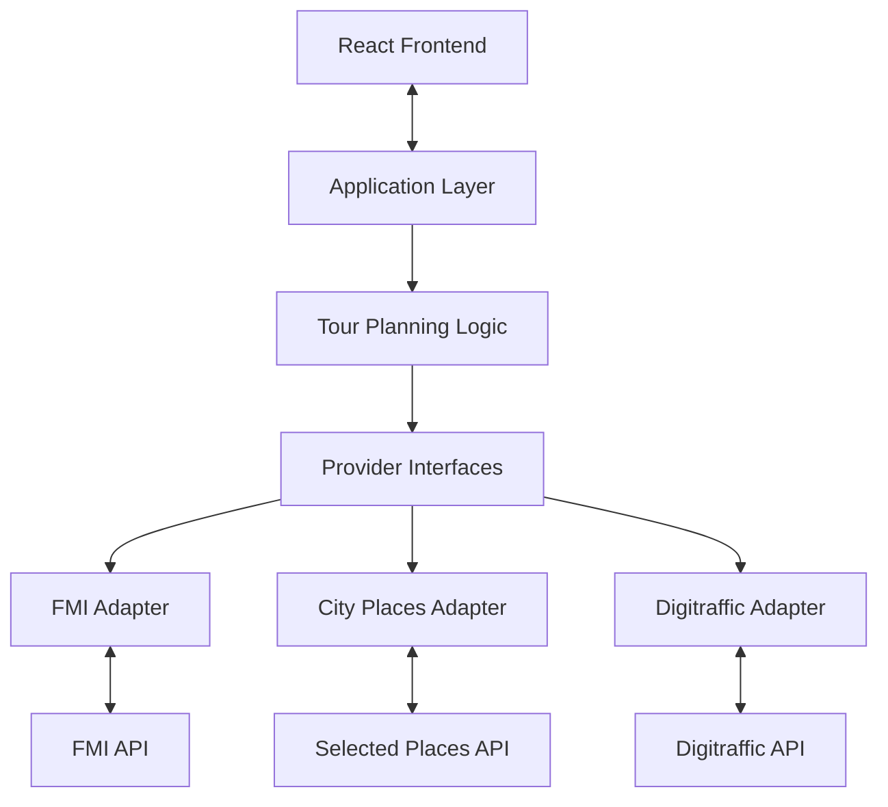

# City Tour Planner
## Prototype and Initial Design

**Course:** COMP.SE.110 Software Design, 2026–2027  
**Project:** City Tour Planner  
**Submission:** Prototype and initial design

---

## 1. Project Overview

We are developing City Tour Planner to help users plan city visits around their available time, preferences, and weather conditions. Users select a city, date, start time, and tour duration. Our application combines information from external data sources and uses its own planning logic to suggest an ordered set of places to visit.

Our intended results include a map, an ordered list of stops, weather information, and relevant traffic announcements when available. We designed the application to support multiple cities rather than limiting it to one location. We initially used Helsinki to investigate candidate APIs and understand the available data. Our map and city-selection design allows us to extend the application to other cities using suitable data providers.

### 1.1 Main user workflow

1. The user selects a city, date, start time, and tour duration.
2. Our application retrieves relevant weather, place, and traffic information.
3. We process the available data and apply our tour-planning rules.
4. Our planning logic selects and orders suitable places within the requested duration.
5. We display the suggested itinerary, map, weather visualization, and available traffic information.
6. The user can show or hide relevant data layers in the results view.

### 1.2 Scope

We intend the initial version to support:

- Tour planning for multiple cities using appropriate data providers.
- Planning based on the selected date, start time, and duration.
- Filtering and ordering places using application-side logic.
- Weather-aware recommendations when suitable forecast data is available.
- A map and an ordered list of suggested stops.
- Weather visualization and optional traffic information.
- Clear feedback when an external data source is unavailable.

Booking, payments, user accounts, live GPS tracking, and guaranteed optimal pedestrian routing are outside our initial scope. We will only present walking times, train information, and precipitation probabilities as factual results when they are supported by suitable data sources. Where we use estimates, we will distinguish them from verified measurements.

---

## 2. Data Sources and API Research

Before designing our integrations, we built a separate **API Research Runner** to test candidate endpoints. It records HTTP status codes, response times, content types, response previews, and errors in a JSON report. This helped us understand how the candidate services respond before integrating them into our application.

The endpoints we tested returned HTTP 200 during our initial research. This confirms that the requests succeeded at the HTTP level, but we distinguish that result from confirming the availability of every field needed by our planning logic.

### 2.1 Weather — Finnish Meteorological Institute (FMI)

**Purpose:** Provide forecast information for the selected city and time.

We investigated FMI Open Data as our weather source. Our tested endpoint returned an XML response. We plan to use the available forecast measurements and timestamps in the weather visualization and, where the data supports it, in our weather-aware place selection.

We will interpret each measurement according to its actual unit and time coverage. We will not assume that precipitation probability or another specific forecast field is available unless it is present in the data we retrieve.

### 2.2 Traffic — Digitraffic

**Purpose:** Provide road traffic announcements relevant to the selected area.

We tested the Digitraffic traffic-announcements endpoint, which returned JSON. We intend to use relevant announcements as additional context for the planned tour.

The endpoint we tested provides road traffic announcements; it does not establish the availability of train departure times or delays. We therefore treat rail information as outside the current integration unless we introduce and test a suitable additional source.

### 2.3 Places — Service Map and city-specific providers

**Purpose:** Supply place and service records that we can filter into potential tour stops.

We tested the Helsinki Service Map `/unit/` endpoint, which returned JSON. The service includes general city services, so we need to filter its records by relevant categories and fields rather than treating every returned unit as a tourist attraction.

During our design discussions, we considered how the map and city-selection functionality could support locations beyond Helsinki. We have therefore designed the application around a selected city and a provider integration layer rather than hardcoding Helsinki into the planning logic. We will use suitable place-data providers according to the selected city's coverage, allowing us to extend the application to other cities without redesigning the entire workflow.

The Service Map is useful for Helsinki and other municipalities in the Helsinki metropolitan area. For cities outside its coverage, our design allows us to integrate alternative providers that supply relevant place data.

References:

- [Helsinki Service Map API documentation](https://www.hel.fi/palvelukarttaws/restpages/ver4.html)
- [Service Map dataset information](https://avoindata.suomi.fi/data/en_GB/dataset/paakaupunkiseudun-palvelukartan-rest-rajapinta)

### 2.4 How we combine the data

The external APIs supply raw information; our application turns that information into a proposed itinerary.

Our intended process is to identify the selected city's available data sources, retrieve the relevant weather, place, and traffic information, normalize provider-specific responses into application-level models, filter places according to our planning rules, and select and order stops within the requested duration.

We keep provider-specific processing separate from our planning logic so that different data sources can be integrated without rewriting the entire application. We also distinguish real provider data from estimates and handle missing information explicitly instead of inventing values.

---

## 3. Planned Technologies

| Area | Technology | Intended use |
|---|---|---|
| Backend | Java 22, Spring Boot 3.5.6 | Application workflow and tour-planning logic |
| Build | Maven | Java dependency management and builds |
| API communication | Java HTTP Client or suitable Spring HTTP support | External API requests |
| Configuration and data | YAML, Jackson | Configuration and JSON processing |
| Weather | FMI Open Data | Forecast information |
| Traffic | Digitraffic | Road traffic announcements |
| Places | Helsinki Service Map and additional providers | Place data for supported cities |
| Frontend | React with Vite | Planning form and results interface |
| Map | Leaflet with OpenStreetMap tiles (proposed) | Display places and the suggested stop sequence |
| Charts | Recharts or Chart.js | Weather visualization |
| Frontend integration | REST API with JSON and browser `fetch` | Communication with the Java backend |
| UI prototype | Figma | Screen designs and prototype interactions |

We have established the main technology direction while leaving a few implementation-level choices flexible. We will select the final HTTP integration and charting libraries according to the needs of the implementation.

Our API Research Runner is a separate development utility. It helps us investigate external services and is not itself a production component of City Tour Planner.

---

## 4. Initial Software Architecture

We separate the frontend, application workflow, tour-planning logic, and external API integrations. This keeps the planning logic independent of the response formats used by individual providers and makes it easier for us to add data sources as we extend city support.

### 4.1 Main components

**Frontend**

Our React frontend collects the user's city, date, start time, and tour duration. It displays the loading state, itinerary, map, weather chart, and traffic information when available. The results view includes controls for showing and hiding data layers.

**Application layer**

Our application layer receives and validates tour requests, coordinates data retrieval and planning, and returns the generated result to the frontend.

**Tour-planning logic**

Our planning logic filters places using the available data and user selections, applies weather-aware rules where supported, and selects and orders stops within the requested duration.

**API integration layer**

We use provider interfaces and adapters to isolate external API requests and convert provider-specific responses into application-level models.

**External providers**

Our initial integrations focus on:

- FMI for weather forecasts.
- Helsinki Service Map and additional providers for place data.
- Digitraffic for road traffic announcements.

### 4.2 Component interaction

The diagram shows our proposed component structure. It describes the architecture we intend to implement, not a claim that every component is already complete.

### 4.3 Request flow

1. The user submits a tour request through our frontend.
2. The backend validates the request and identifies the data providers suitable for the selected city.
3. Our integration layer retrieves the relevant weather, place, and traffic data.
4. Provider adapters normalize the responses into application-level models.
5. Our planning logic filters and orders candidate places.
6. The backend returns the itinerary and visualization data.
7. The frontend displays the results and any relevant data-availability messages.

We designed the workflow to tolerate partial data availability. If one provider fails, our application can explain the limitation and use other suitable data where possible instead of silently treating missing information as valid.

---

## 5. Design Approach

### 5.1 Adapter pattern

We chose the Adapter pattern as a suitable approach for integrating external providers with different endpoints and response formats.

For example, we can use `FmiWeatherAdapter`, `ServiceMapPlacesAdapter`, other city-specific place adapters, and `DigitrafficAdapter`. Each adapter converts the corresponding external response into our application's data models.

This keeps provider-specific details out of the tour-planning logic. It also supports our multi-city design because we can add or replace a place provider without rewriting the whole planning workflow.

### 5.2 Strategy pattern

We may need different selection rules for general, indoor-focused, and outdoor-focused tours. We can represent these rules through a common strategy interface if they become sufficiently different.

For the initial version, we intend to keep the planning logic proportionate to the requirements. We will introduce separate strategy implementations where they improve the design rather than adding abstractions that do not provide a clear benefit.

---

## 6. UI Prototype

Our Figma prototype demonstrates the intended user journey from entering tour preferences to reviewing the suggested itinerary.

**Prototype:** [City Tour Planner — Figma](https://www.figma.com/proto/xLJSzzdVMFzEHprbCb2SrW/City-Tour-Planner-Prototype?node-id=0-1&t=c8UDhzHjZfPHAGFD-1)

### 6.1 Planning screen

Our planning screen provides a city selector, date, start time, tour-duration options, and a Generate Tour action. It introduces the main features: weather information, traffic information, places, and the proposed itinerary.

The selected city determines which data providers our backend uses. This supports our decision to design City Tour Planner for multiple cities rather than building the workflow around Helsinki alone.

### 6.2 Loading screen

Our loading screen communicates progress while information is retrieved from external sources. It presents weather, road traffic, and places as separate retrieval steps so users can understand what the application is processing.

In the implementation, these indicators will reflect actual request states. We intend to handle failed or delayed requests without leaving the user waiting indefinitely.

### 6.3 Results screen

Our results screen brings together the main outputs:

- A map with numbered stops and a suggested visit sequence.
- A stop list with names, categories, and planned visit times.
- An hourly weather chart and tour-window indicator.
- Data-layer toggles for weather, transport, and places.
- An explanation of how weather influenced the suggested tour.
- Road traffic announcements when available.

We also designed a results state in which traffic announcements are unavailable. This demonstrates how the application can communicate a missing data source rather than silently presenting unavailable information as valid.

The map routes, sample stop timings, and weather values shown in the prototype are illustrative unless backed by validated data. In the implementation, we will distinguish actual measurements and route information from estimates or placeholders.

### 6.4 Prototype screenshots

We use screenshots exported from our Figma prototype to document the main states. The screenshots are stored in `frontend/screen-design/`.

Recommended figures for the submission:

1. **Planning screen:** City and tour preferences.
2. **Loading screen:** Progress of data retrieval.
3. **Results screen:** Map, weather, and place layers.
4. **Unavailable-traffic state:** Results when traffic information cannot be retrieved.

We include separate results screenshots because the unavailable-traffic state demonstrates an important behavior that is not visible in the standard results screen.

---

## 7. Team Contributions and Responsibilities

We have four members in our group and have provisionally divided the work by area so that we can develop the application in parallel while coordinating integration.

| Member | Main area | Contribution and planned responsibilities |
|---|---|---|
| **Varun Ganesh Sondur** | Backend architecture and API integration | Built the API Research Runner, investigated external API feasibility, and contributed to project planning and architecture. Will focus on provider adapters, backend integration, and tour-planning logic. |
| **Pham Thanh** | Frontend and UI | Designed the Figma prototype and contributed the screen content based on API findings. Will focus on the planning form, results layout, map, weather chart, data-layer controls, and frontend-to-backend integration. |
| **Georgios Malezoglou** | Tour-planning logic and data processing | Will help define place filtering, weather-aware selection rules, stop ordering, duration estimates, and tests for planning behavior. |
| **Abdullah** | Testing and integration support | Will help test API and application behavior, check city-specific data integration, test unavailable-data scenarios, and coordinate technical documentation and integration checks. |

This is our working allocation for the project. We will coordinate shared tasks and adjust responsibilities when needed. We intend for all members to review the overall design and understand how their components integrate with the rest of the application.
___
8. AI Tool Usage Disclosure

We used AI tools as part of our project preparation and development workflow, including exploring design options, supporting spec-driven development, reviewing and optimizing code, and considering architectural and implementation decisions. Our use of these tools supported the development process rather than replacing our own technical judgment.

We treat AI-generated suggestions as input rather than automatically accepting them. We review relevant outputs, consider design trade-offs, and check technical claims against API responses, available documentation, and implementation tests where applicable. We remain responsible for our final requirements, design decisions, code, and submitted work.

This disclosure describes our collective workflow. Any tool-specific attribution or additional AI use should be documented accurately based on the work actually performed by the team.
___
## 9. Implementation Considerations

Our initial research and design have highlighted several considerations that shape how we will implement the application:

- **City-specific data:** We select suitable data providers for each city rather than assuming one source covers every location.
- **Place relevance:** We filter general service records so that the itinerary contains places suitable for a city visit.
- **Forecast interpretation:** We use forecast measurements according to their actual units, timestamps, and available coverage.
- **Traffic information:** We treat road traffic announcements separately from train schedules and delays.
- **Routing and duration:** We distinguish estimated travel or visit times from values supported by verified routing data.
- **Partial failures:** We provide useful feedback when a provider is unavailable and use other suitable data when possible.
- **Planning rules:** We use the available weather and place information to influence stop selection without assuming data that we have not retrieved.

These considerations follow directly from our API research and the behavior represented in our prototype. They help us keep the planned user experience consistent with the information our application can actually provide.

---

## 10. Conclusion

We designed City Tour Planner as a multi-city tour-planning application that combines weather, place, and traffic information with our own planning logic. We initially tested APIs using Helsinki as our starting location and designed the application so that additional cities can be supported through suitable data providers.

Our proposed architecture separates the frontend, application workflow, planning logic, and provider integrations. We chose this structure to keep external API details separate from the itinerary-generation process and to make the application easier to extend. Our Figma prototype demonstrates the planning workflow, loading feedback, results visualization, and handling of unavailable traffic information.

Our next implementation steps are to connect the agreed components, build the planning logic, integrate the frontend with the backend, and test the application against real API responses. We will use the results of these tests to refine the itinerary and ensure that displayed information accurately reflects the available data.

---

## Submission Checklist

- [ ] Include the relevant Figma screenshots with readable captions.
- [ ] Render and review the architecture diagram.
- [ ] Confirm the team-responsibility table with all four members.
- [ ] Confirm that the AI usage disclosure reflects the team's actual workflow.
- [ ] Ensure that illustrative weather values and routes are not presented as live data.
- [ ] Check that the document matches the current prototype and API Research Runner results.
- [ ] Tag the final prototype submission as `proto-version`.
